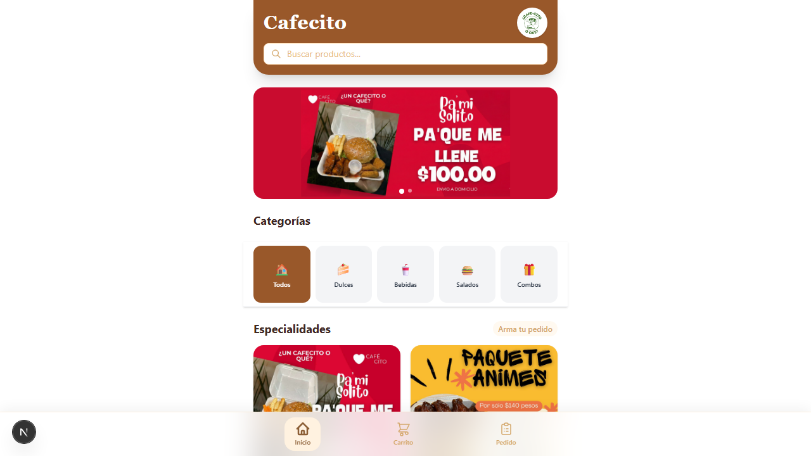
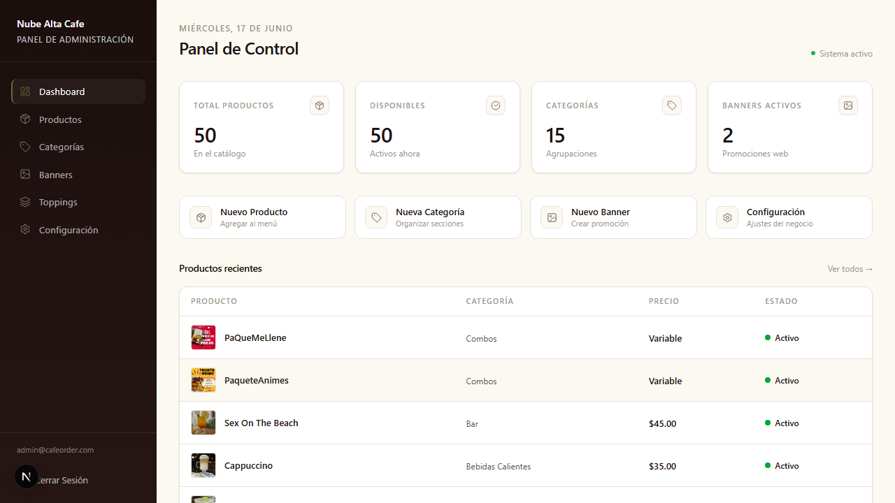

# Cafecito — Menú Digital con Pedidos por WhatsApp

[](https://github.com/cutberto-cast/WhatsCoffee/actions/workflows/ci.yml)

Aplicación full-stack de menú digital para una cafetería: catálogo de productos con variantes/toppings/ingredientes personalizables, carrito, checkout que genera un mensaje de WhatsApp listo para enviar, y un panel de administración completo para gestionar el negocio sin tocar código.

🔗 **Sitio en vivo:** https://cafecito.shop

## Capturas

| Tienda (cliente) | Panel de administración |
|---|---|
|  |  |

## Stack

- **Next.js 16** (App Router, Turbopack) + React 19 + TypeScript
- **Supabase**: Postgres con Row Level Security, Auth (email/password) y Storage para imágenes
- **Tailwind CSS 4** + **Zustand** (estado del carrito) + **Zod**
- **Playwright** para verificación end-to-end manual del flujo de compra y admin

## Funcionalidad

**Tienda pública**
- Catálogo filtrable por categoría, con buscador
- Productos con variantes (ej. sabor), toppings opcionales con límite de gratuitos, e ingredientes removibles
- Carrito persistente y checkout que arma el pedido como mensaje de WhatsApp (`api.whatsapp.com/send`)
- Pago por efectivo o transferencia (muestra los datos bancarios configurados por el admin)

**Panel admin** (`/admin`, protegido con Supabase Auth)
- CRUD de productos, categorías, banners promocionales y toppings
- Editor de variantes e ingredientes por producto
- Configuración del negocio (nombre, WhatsApp, color de marca, datos bancarios)
- Subida de imágenes a Supabase Storage
- Bloqueo temporal tras 5 intentos fallidos de login (protección básica anti fuerza bruta)

## Arquitectura

```
Next.js (App Router)
 ├─ app/                  rutas públicas (/, /privacidad) y admin (/admin/**)
 ├─ components/           UI de tienda, carrito y admin
 ├─ lib/supabase/         clientes Supabase (browser y server, vía @supabase/ssr)
 ├─ stores/               estado del carrito (Zustand)
 └─ types/                tipos del dominio

Supabase (Postgres + Auth + Storage)
 ├─ RLS: lectura pública en catálogo, escritura solo para usuarios "authenticated"
 └─ Esquema preparado para multi-tenant (tabla cafeterias / cafeteria_id),
    aunque la app actual opera en modo single-tenant
```

## Correr el proyecto localmente

La aplicación está en la carpeta `cafeorder`. Desde la raíz del repositorio,
entra primero con `cd cafeorder`.

En Windows con PowerShell, usa `npm.cmd` si aparece el error de que
`npm.ps1` no se puede ejecutar porque la ejecución de scripts está deshabilitada:

```powershell
cd C:\Proyectos\MenuDigital\cafeorder
npm.cmd install
# Solo si todavía no existe .env.local:
Copy-Item .env.example .env.local
# Completa las dos variables de Supabase en .env.local antes de arrancar.
npm.cmd run dev
```

Abre http://localhost:3000 (administración: http://localhost:3000/admin).
Si `.env.local` ya está configurado, consérvalo. Reinicia el servidor después
de cambiar variables de entorno. El servidor corre en tu equipo, pero los datos,
la autenticación y las imágenes siguen dependiendo del proyecto remoto de
Supabase y requieren conexión a Internet.

```bash
npm install
cp .env.example .env.local   # completa con tu propio proyecto Supabase
npm run dev
```

### Variables de entorno

| Variable | Descripción |
|---|---|
| `NEXT_PUBLIC_SUPABASE_URL` | URL del proyecto Supabase |
| `NEXT_PUBLIC_SUPABASE_ANON_KEY` | Clave pública (anon) del proyecto Supabase |

El esquema base (tablas `productos`, `categorias`, `cafeterias`) se administra desde el dashboard de Supabase. Las migraciones incrementales posteriores (variantes/toppings, banners) están versionadas en `supabase/migrations/`.

## CI

Cada push a `main` corre lint + build vía GitHub Actions (`.github/workflows/ci.yml`).
